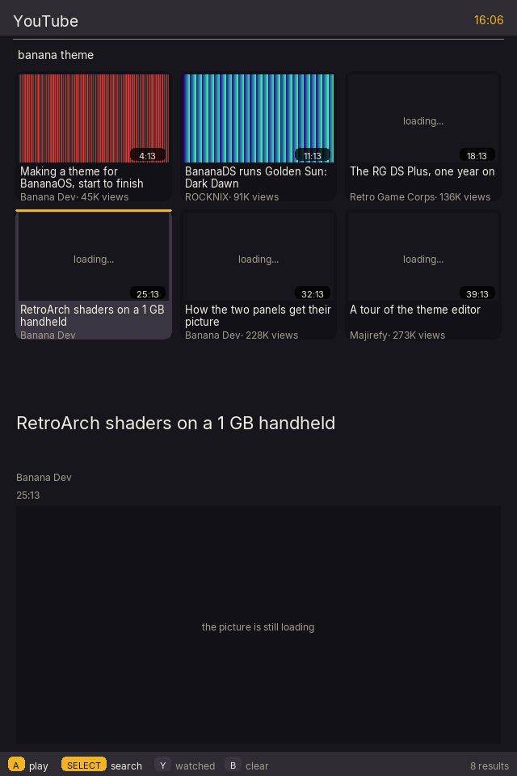
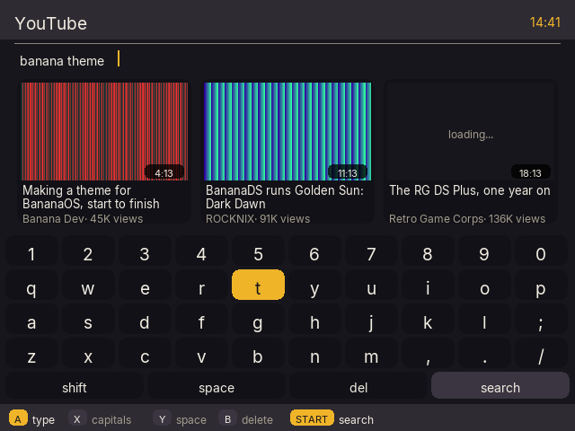
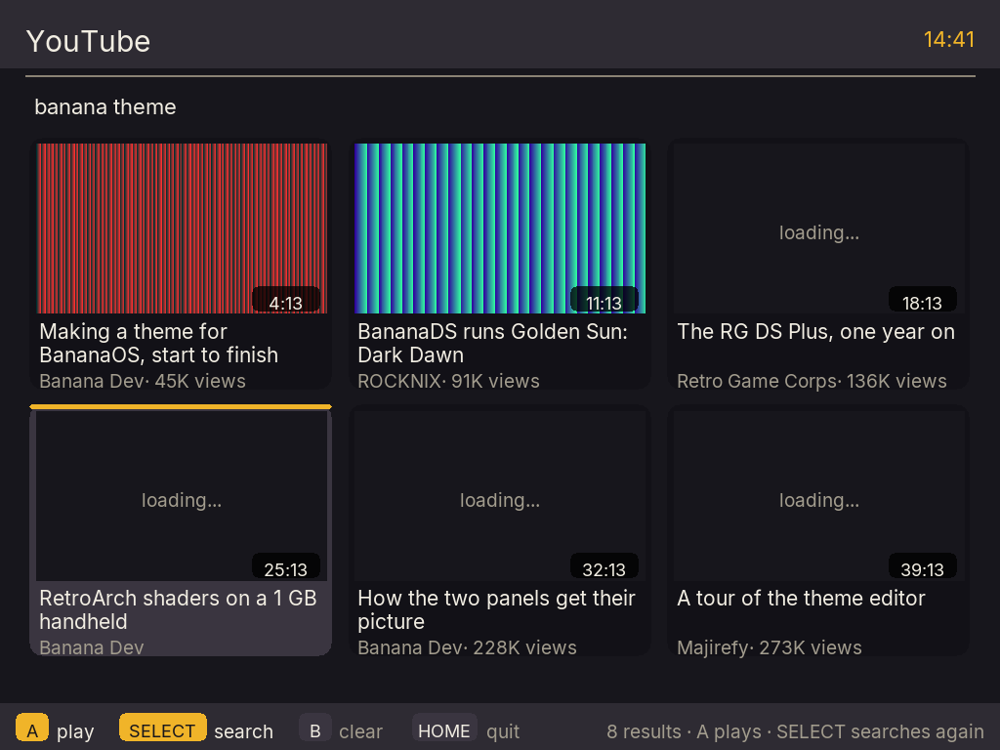
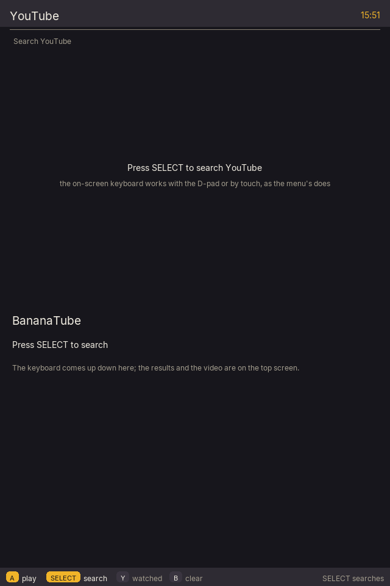
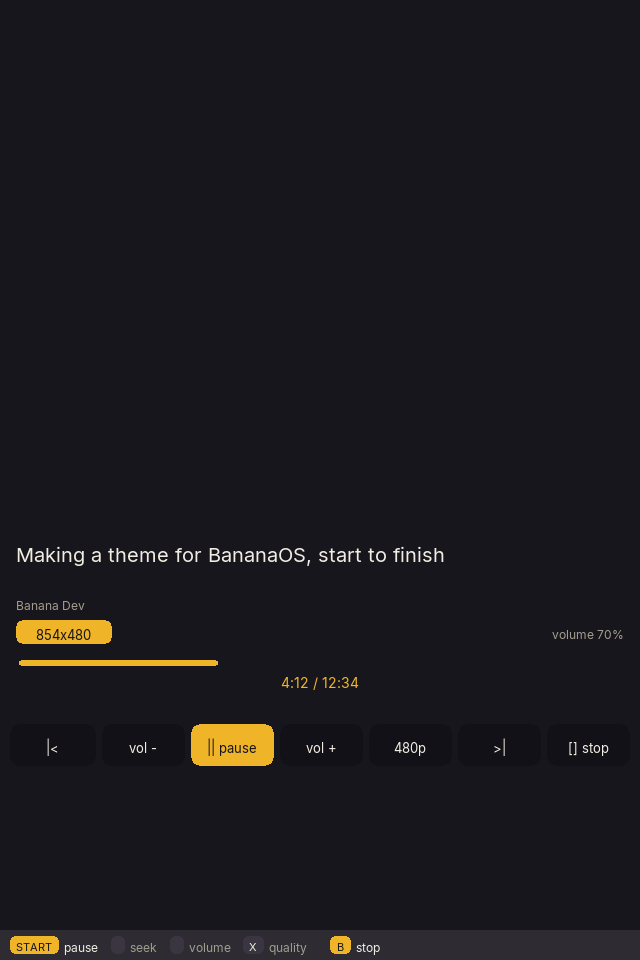
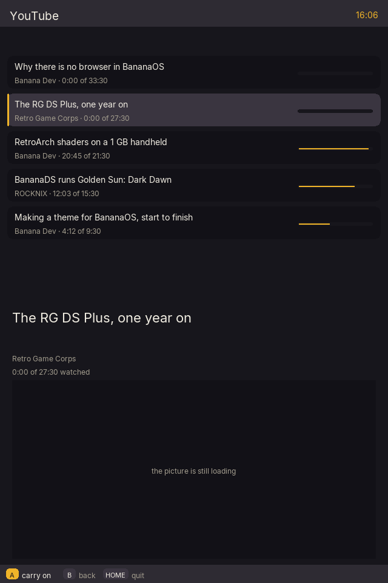
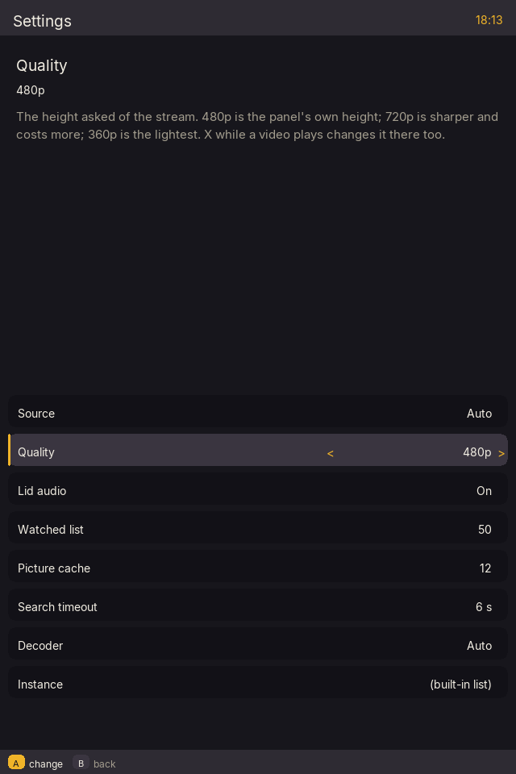

# BananaTube

A native dual-screen YouTube client for [BananaOS](https://github.com/JorreFog/BananaLinux) on the Anbernic RG DS
and RG DS Plus (Rockchip RK3568, 1 GB of RAM, two 640x480 panels).

The video goes on the top panel, hardware-decoded. The search, the results and the transport controls are on the
bottom one, drawn by the CPU straight into DRM buffers. There is **no browser, no WebView, no Electron, no Qt, no
SDL** and — the point of the whole thing — **no `yt-dlp` on the search path**: searching is one HTTP request
parsed with cJSON, because spawning a Python interpreter on a Cortex-A55 costs ~70 MB and 3–5 seconds.

## Status

Phase 1 (this repository's first commit) — the skeleton, built and tested:

| | |
|---|---|
| ✅ | Both panels from one process: `GBM`/`EGL` on the top, DRM dumb buffers on the bottom |
| ✅ | DRM master taken from bananad and dropped on exit, so the menu comes back |
| ✅ | Buttons, touchscreen and lid read from `/dev/input` (`BTN_EAST` is A, `BTN_SOUTH` is B: the RG DS's layout) |
| ✅ | The software screen: draw lists, damage diffing, `memcpy` blits, rounded boxes, text through FreeType |
| ✅ | The backend core: Invidious/Piped and InnerTube, the stream-format rules, the thumbnail cache, settings |
| ✅ | `buildroot/package/bananatube` and the launcher `system/run-bananatube` |
| ✅ | **Phase 2**: the search field and on-screen keyboard, the results grid, and pictures fetched and decoded on background threads |
| ✅ | **Phase 3**: libmpv rendering the video into the top panel's EGL surface, hard-decoded, with the memory caps in force and an overlay; the bottom screen becomes the player's |
| ✅ | **Phase 4**: a transport row (pause, seek, volume, quality, prev/next, stop) that is tapped or driven by the buttons; a watched list that carries on where it stopped; and audio-only with the lid shut |
| ✅ | The app's own settings screen (**START** on the results): backend, quality, lid audio, the watched list's size, the picture cache, the search timeout, the decoder and the instance URL, written to `bananatube.conf` as they change |

**The top panel carries the content and the bottom one the controls.** The search field, the results grid and
the video are on the top screen — the main one, where BananaOS's own menu is — and the bottom screen, the one with
the touchscreen in it, has the keyboard while you type, the transport row while a video plays, and what is
selected the rest of the time. So the grid is on the screen you look at, and every control is under a finger.

The video is decoded by the RK3568's video unit. The overlay along the bottom of it (the resolution being decoded,
the position, a spinner while it buffers, and the frames it had to drop) is drawn by the same renderer as the
bottom screen and uploaded as one texture.

Every picture below is both panels, stacked the way the two screens sit on the handheld. They are drawn by the
same code the handheld runs: `bananatube --shot` renders the client into a buffer with no DRM, no GPU and no
network (see [Test](#test)).

| | |
|---|---|
| The results grid |  |
| Typing a search |  |
| The same, on the Plus |  |
| Before a search |  |
| Playing a video |  |
| Carrying on |  |
| Settings |  |

## The controls

| | |
|---|---|
| Browsing | **SELECT** (or **X**) opens the keyboard · **A** plays what is selected · **Y** the watched list · **B** clears the results · **HOME** leaves |
| Typing | **A** types the key under the cursor · **B** deletes · **X** capitals · **Y** space · **START** searches · **SELECT** puts the keyboard away · the D-pad moves |
| Playing | **START** pause · **LEFT**/**RIGHT** or **L2**/**R2** seek ±10 s · **UP**/**DOWN** volume · **L1**/**R1** previous/next video · **X** the quality (360p → 480p → 720p) · **B** stops · **HOME** leaves |
| Settings | **START** on the results opens the app's own settings · the D-pad moves · **A** or **LEFT**/**RIGHT** changes a value · **A** on the instance row opens the keyboard (**START** saves it) · **B** goes back |
| By touch | The keyboard, the transport row, the settings list and everything on the bottom panel are tappable; the top panel has no touchscreen |

**The search needs Wi-Fi.** Settings ▸ Network joins a network; without one the app says "Could not reach
YouTube. Is Wi-Fi on?" rather than pretending it searched.

## Getting it on the handheld

The Buildroot package (`buildroot/package/bananatube/`) builds the binary, installs the launcher and puts the
app folder on the shelf. **Two lines live outside the package**, both written out as snippets: the menu needs a
systems list entry to show the tile (`system/systems.conf.snippet`, into `/etc/banana/systems.conf` — or the
card's `/data/banana/systems.conf`, which the menu prefers when it is there), and the theme needs the `[app]`
marker to make that tile an app, so A starts it rather than opening a folder of one game
(`system/systems.cfg.snippet`). Nothing else in BananaOS has to change.

The client is started the way a game is: the menu lets go of the panels and runs `run-bananatube`, which takes
the DRM master, plays, and gives it back when it exits — bananad's handover, the same one BananaDS uses.

**[docs/TESTING.md](docs/TESTING.md)** is what to look for on the handheld: the panels, the touch mapping, the
decoder, the lid against bananad's sleep, and the memory numbers — everything the host tests cannot check.

## Build

Needs `cmake`, a C11 compiler, and the dev packages for `libdrm`, `egl`, `glesv2`, `gbm`, `freetype2`, `libjpeg`,
`libcurl` and `cJSON` (on Arch: `libdrm mesa freetype2 libjpeg-turbo curl cjson`).

```sh
cmake -S . -B build -DCMAKE_BUILD_TYPE=Release
cmake --build build -j4
```

For the handheld it is built by Buildroot; see `buildroot/package/bananatube/`.

## Test

```sh
sh tests/run.sh          # configures, builds and runs every host test
```

The tests need no DRM device, no GPU and no network. They cover the parts where being wrong is expensive and
invisible:

| | |
|---|---|
| `drawlist` | the damage diff: a wrong one smears or freezes the bottom screen |
| `select` | the stream rules: choosing AV1, which the RK3568's video unit cannot decode, pegs all four cores |
| `render` | the software renderer at 1.0 **and 1.6**: a draw that forgets to scale is invisible on the RG DS and paints an empty tile over its neighbour on the Plus (it did) |
| `parse` | both backends' replies, from canned bodies |
| `ui` | the grid's geometry and selection, the keyboard, and what each button means |
| `settings` | the app's own settings screen: the rows, cycling a value, the instance typed with the keyboard, and that a change reaches the `Conf` |
| `worker` | the thumbnail queue and the JPEG decode, with the fetch injected: a real JPEG, decoded off the thread |
| `player` | that libmpv's options *took*: the 16 MiB demuxer cache, no cache, no yt-dlp of its own, no config file — the settings that decide whether a 1 GB handheld survives |
| `history` | the watched list: it survives a restart, moves an opening video to the front, keeps a fractional position through the JSON round trip, and obeys (and clamps) `history_size` |
| `args` | what the menu's argument means: its own marker file is not a search, "apples" is |
| `keys` `conf` `lru` | the button mapping, the settings file, the picture cache |

They have already paid for themselves: two real bugs (a title arriving as a plain string in the player reply,
and a picture painted at the wrong scale) were caught this way rather than on hardware.

What the tests cannot check is what needs the device: whether the kernel's `v4l2m2m-copy` decodes 480p60 and
720p60 without dropping frames, and whether the overlay's orientation matches the video's (one flag, if it does
not — see `docs/ARCHITECTURE.md`). What the *build* settled first is that `rkmpp-copy` is not available at all:
BananaOS's ffmpeg has the kernel's v4l2m2m decoders and no Rockchip MPP library.

## Run

On a handheld, the menu starts it through the launcher:

```sh
/usr/libexec/banana/run-bananatube
```

On a computer, the display half needs two DSI connectors, so it will stop at "no DRM device with two connected
panels" — which is itself the useful test that the DRM walk is right:

```sh
BANANA_TOP=DSI-2 ./build/bananatube
```

## How it is put together

```
src/
  main.c                  the loop: poll the display and the input, draw a frame, flip
  util.c conf.c font.c
  display/
    draw.h drawlist.c     a frame as a list of draws, and the damage between two frames
    drm.c                 the two panels, dumb buffers, CRTCs, vblank
    gbm_egl.c             the top panel's GBM surface and EGL context (where libmpv will draw)
    bottom.c              the software renderer for the bottom panel
  input/
    keys.c                evdev codes -> A/B/X/Y/L/R/START/SELECT/HOME
    evdev.c               the gamepad, the touchscreen and the lid
  net/
    backend.h             what the app asks of YouTube; the format rules
    http.c                libcurl, capped replies, cJSON helpers
    invidious.c           an Invidious/Piped instance (search, video, formats)
    innertube.c           YouTube's own /youtubei/v1 API (Android VR client: no cipher)
    resolver.c            id -> playable URL, and the last-resort yt-dlp run
    thumbnail.c           a fixed-size LRU of small RGB565 textures, and a JPEG decoder
  player/                 (Phase 3) libmpv: one surface, the RAM caps, the OSD
  ui/                     (Phase 2) the search screen, the keyboard, the results grid, the settings screen
tests/                    the host tests
buildroot/package/        the Buildroot package
system/run-bananatube     the launcher bananad starts
docs/ARCHITECTURE.md      the design, and why each choice was made
```

## The two decisions worth knowing

**No SDL, no Wayland, no compositor.** BananaOS has none of them: `banana-ui` opens both DRM/KMS connectors
itself, and BananaDS drives the panels through `libdrm` with Panfrost for the GPU. This follows the same path —
EGL on GBM for the panel libmpv draws to, dumb buffers for the panel the CPU draws. A windowing library would
add a dependency and an abstraction the rest of the system does not have, and buy nothing.

**The backends are tried in order, and nothing is spawned to search.** An Invidious/Piped instance first (one GET,
plain URLs, no cipher), YouTube's InnerTube API next (the Android VR client still answers without a
`signatureCipher`), and only if both fail does a single, tightly scoped `yt-dlp -g` run — once per video, at the
moment it is played, with its ~70 MB freed before libmpv opens the stream.

## License

GPL-3.0-or-later — the same as BananaOS. See [LICENSE](LICENSE).
---

## Support

If you'd like to support the project, you can buy me a coffee on Ko-fi:

**[https://ko-fi.com/jesussavesai](https://ko-fi.com/jesussavesai)**

And honestly -- paid or free, it all means a lot to me. A donation, a star, a bug report, or just using what I make: thank you. ❤️
